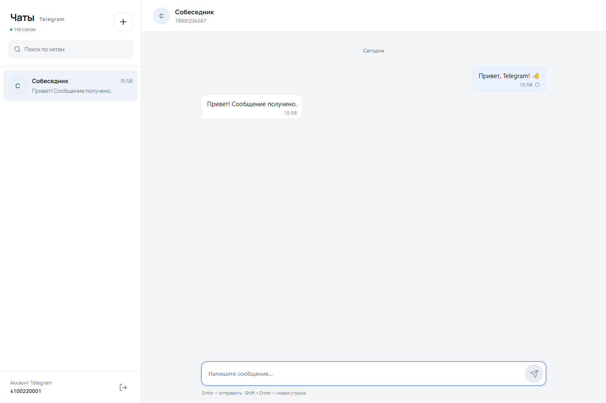
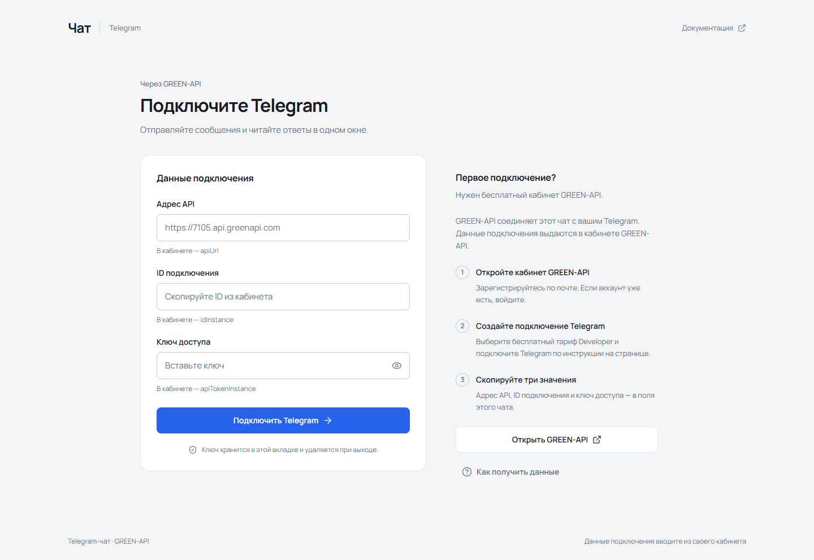

# Telegram · GREEN-API

React-клиент для отправки и получения текстовых сообщений **Telegram** через GREEN-API. Подключение по данным своего инстанса, чат по телефону, HTTP long polling, статусы доставки, ручной повтор отправки и адаптивный интерфейс.

Обычная сборка обращается к реальному API. Имитация ответов используется только в автоматических тестах.





## Локальный запуск

Нужен **Node.js 22.12+**. В папке проекта:

```sh
npm ci
npm run dev
```

Откройте адрес, напечатанный Vite, обычно http://127.0.0.1:5173.

Production-сборка и локальный просмотр:

```sh
npm run build
npm run preview
```

`dist/` содержит статическое приложение для HTTPS-хостинга. Данные подключения вводятся в интерфейсе; реальные ключи не нужно добавлять в исходники или переменные окружения сборки.

## Как подключить Telegram

1. Откройте [кабинет GREEN-API](https://console.green-api.com/), создайте подключение Telegram и авторизуйте свой аккаунт по инструкции в кабинете. Такое подключение называется «инстансом».
2. Скопируйте `apiUrl`, `idInstance`, `apiTokenInstance` в поля **«Адрес API»**, **«ID подключения»**, **«Ключ доступа»**. Используйте адрес API именно своего инстанса. Пароль от Telegram в поле ключа не вводится.
3. Нажмите **«Подключить Telegram»**. Приложение проверяет состояние инстанса, его тип и настройки уведомлений. Если они выключены, нажмите **«Настроить приём сообщений»**. Эта явная настройка включает уведомления, очищает прежний Webhook URL и может вызвать перезапуск подключения; после применения подключитесь повторно.
4. Создайте **«Новый чат»** по международному телефону получателя с кодом страны, например `+49 151 12345678` или `+7 999 1234567`. Код страны сохраняется; местный номер следует вводить вместе с международным кодом.
5. Отправьте текст: **Enter** — отправка, **Shift+Enter** — новая строка. Максимальная длина — **4096 символов**. Получатель отвечает в обычном Telegram; ответ должен появиться в этом чате.

Для проверки доставки нужен отдельный получатель, согласный получить сообщение и ответить. Аккаунт GREEN-API ему не требуется. Скрытый номер или ограничения поиска по телефону могут помешать проверке аккаунта.

Для HTTP-приёма нужны пустой `webhookUrl` и флаги `incomingWebhook`, `outgoingWebhook`, `outgoingAPIMessageWebhook`, `outgoingMessageWebhook`, `stateWebhook` со значением `yes`. Используйте один HTTP-потребитель очереди на инстанс: другая программа может забирать его уведомления.

## Если подключение не отвечает

Во время диагностики **13 октября 2026 года** TCP-соединение с API сервера 4100 завершалось таймаутом как через VPN, так и при прямом подключении через Wi-Fi. На [официальной странице статуса GREEN-API](https://status.green-api.com/) в это время отмечались проблемы компонентов `Instances4100` и `Notifications4100`.

Ответ API с результатом проверки ключа не был получен: корректность ключа и реальная доставка этим запросом не подтверждены. Состояние сервиса может измениться после диагностики; проверяйте страницу статуса перед повторной попыткой.

При таймауте или отсутствии сетевого ответа форма показывает ссылку **«Проверить статус GREEN-API»**, сохраняет введённые значения и снова позволяет нажать **«Подключить Telegram»**. Автоматический повтор подключения не обещается. После восстановления сервиса повторите подключение вручную.

Технические доказательства и снимок официального мониторинга — в [отчёте о доступности API](docs/API_AVAILABILITY.md).

## Поведение

- `checkAccount` получает постоянный Telegram `chatId` по номеру. Отправка и сопоставление ответов используют этот ID.
- HTTP 200 у `sendMessage` означает постановку **«В очередь»**. Статусы **«Доставлено»** и **«Прочитано»** появляются по уведомлениям API.
- Получение последовательное: `receiveNotification → обработка → deleteNotification`. События неподдерживаемых типов также подтверждаются; повторно полученное сообщение не дублируется.
- После временного сетевого сбоя приём возобновляется с задержкой. Ошибка доступа требует переподключения.
- Отправка автоматически не повторяется: при таймауте сервер мог принять сообщение. Перед ручным повтором интерфейс объясняет возможность дубликата.
- Ключ, чаты, черновики и история хранятся в памяти текущей вкладки. Выход или перезагрузка очищают сессию.
- Медиа, звонки, группы и загрузка старой истории в этот клиент не входят. Медиа-события подтверждаются, но не отображаются.
- Клиент обращается к HTTPS API GREEN-API. В тестах используются только фиктивные данные подключения.

## Архитектура

React, TypeScript strict, Vite и CSS Modules. Переиспользуемые Button и Dialog используют Radix UI и class-variance-authority; иконки — Lucide, Manrope поставляется локально.

```text
src/
  app/                         # запуск, глобальные токены, ErrorBoundary
  pages/chat/                  # композиция сценариев и сессия
  widgets/chat-workspace/      # список чатов, заголовок, история
  features/
    connect-instance/          # подключение и явная настройка уведомлений
    create-chat/               # проверка телефона и создание чата
    send-message/              # редактор сообщения
    receive-messages/          # отменяемый polling
  entities/chat/               # события, reducer, дедупликация и статусы
  shared/
    api/                       # HTTPS-клиент и проверка ответов
    config/                    # конфигурация Telegram
    lib/                       # нормализация телефона
    ui/                        # переиспользуемые контролы
```

Слайсы предоставляют публичные `index.ts`. ESLint проверяет направления зависимостей FSD. Внешние JSON-ответы проверяются во время выполнения. API-клиент принимает `fetch` для изолированных тестов; reducer и polling не зависят от DOM.

## Автоматические проверки

```sh
npm run check
npx playwright install chromium
npm run test:e2e
```

`check` запускает TypeScript, ESLint, Prettier, unit-тесты и production build. Для установленного Chrome E2E можно запустить без установки браузера:

```powershell
$env:PLAYWRIGHT_EXECUTABLE_PATH = 'C:\Program Files\Google\Chrome\Application\chrome.exe'
npm run test:e2e
```

Mock E2E проверяют UI и HTTP-контракт: подключение, телефон, отправку, входящие события, подтверждение очереди, ошибки, гонки статусов, модальные окна и мобильные экраны. Успешная реальная доставка требует отдельной live-проверки с авторизованным инстансом.

**Проверено 13.10.2026:** TypeScript strict, ESLint, Prettier, **70 unit-тестов**, production build и **23 E2E-сценария** на production preview. E2E используют фиктивный API, включая таймаут и восстановление соединения. Реальная доставка не подтверждена из-за недоступности назначенного сервера 4100. Подробности — в [VALIDATION.md](VALIDATION.md).

## Соответствие заданию

| Требование               | Реализация                                          |
| ------------------------ | --------------------------------------------------- |
| Telegram через GREEN-API | Инстанс с типом `telegram`                          |
| Только текст             | `textMessage` и `extendedTextMessage`               |
| Интерфейс мессенджера    | Список чатов, переписка, редактор и мобильный экран |
| React                    | React + TypeScript, компоненты и hooks              |
| Вход по ID и токену      | Форма подключения и `apiUrl` из своего кабинета     |
| Чат по телефону          | `checkAccount` → Telegram `chatId`                  |
| Отправка                 | POST `sendMessage`                                  |
| Ответ получателя         | HTTP `receiveNotification` и DELETE уведомления     |

## Официальные инструкции

- [Начало работы Telegram](https://green-api.com/telegram/docs/before-start/)
- [SendMessage Telegram](https://green-api.com/telegram/docs/api/sending/SendMessage/)
- [CheckAccount Telegram](https://green-api.com/telegram/docs/api/service/CheckAccount/)
- [Получение через HTTP API](https://green-api.com/telegram/docs/api/receiving/technology-http-api/)
- [ReceiveNotification](https://green-api.com/telegram/docs/api/receiving/technology-http-api/ReceiveNotification/)
- [DeleteNotification](https://green-api.com/telegram/docs/api/receiving/technology-http-api/DeleteNotification/)

Ссылка GitHub, резюме PDF и предпочтительный формат работы относятся к сопроводительным материалам пользователя. Приложение их не отправляет.
